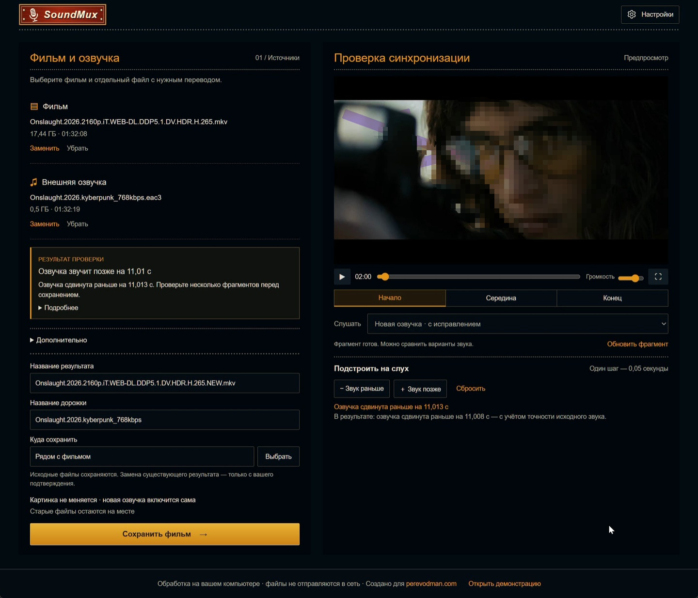

# SoundMux

Windows-программа, которая добавляет к фильму внешнюю озвучку. Берёт фильм (MKV) и отдельный файл озвучки (AC3, E-AC3, FLAC, TrueHD и другие), сама находит, на сколько озвучка сдвинута или растянута по времени, и собирает новый MKV с исправленной звуковой дорожкой.

- Видео не перекодируется, исходные файлы не меняются.
- Синхронизация проверяется на слух: короткий предпросмотр из начала, середины и конца фильма, с ручной подстройкой сдвига.
- Исправляются сдвиг и разница скорости (например 24 и 25 кадров/с, 23,976 и 24), в том числе с сохранением тона.
- Вся обработка идёт локально, файлы никуда не отправляются.



## Скачать и запустить

Готовая портативная версия лежит в разделе [Releases](https://github.com/garik128/SoundMux/releases): скачайте `SoundMux-portable.zip`, распакуйте в любую папку и запустите `SoundMux.exe`. Установка и права администратора не нужны.

Требуется 64-битная Windows 10 или 11 и Microsoft Edge WebView2 (в Windows 11 уже есть). Сборка не подписана, поэтому SmartScreen может показать предупреждение: «Подробнее», затем «Выполнить в любом случае». Подробности и частые вопросы лежат в `README.txt` внутри архива.

## Из чего сделано

Интерфейс на React и TypeScript, оболочка на Tauri 2 (Rust), обработка на встроенном Python с NumPy, сборка файла через FFmpeg, FFprobe и mkvmerge. Устройство, алгоритмы, настройки и сборка описаны в [docs/DEVELOPMENT.md](docs/DEVELOPMENT.md).

## Сборка из исходников

Нужны Node.js, Rust и локально подготовленные медиакомпоненты (FFmpeg, mkvmerge, встроенный Python). Какие именно и куда их класть, написано в [docs/DEVELOPMENT.md](docs/DEVELOPMENT.md).

```powershell
npm ci
npm test
powershell -NoProfile -ExecutionPolicy Bypass -File scripts/package-portable.ps1
```

Последняя команда собирает папку `dist-portable/SoundMux` и архив `dist-portable/SoundMux-portable.zip`.

## Лицензия

Код SoundMux распространяется по лицензии [MIT](LICENSE). Вместе с портативной сборкой поставляются сторонние программы (FFmpeg, MKVToolNix, Python и др.) под своими лицензиями; их тексты и ссылки на исходный код лежат в папке `licenses` внутри архива.
